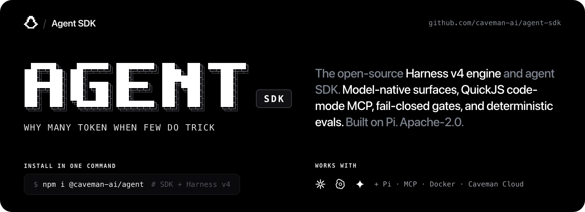

<div align="center">

<a href="https://github.com/caveman-ai/agent-sdk"></a>

# Caveman Agent SDK (`caveman-ai/agent-sdk`)

**The open-source Harness v4 engine and production TypeScript Agent SDK.**<br>
Build, evaluate, and run AI agents in-process on the exact Apache-2.0 harness that powers Caveman Code — or deploy the same definition to Caveman Cloud. Zero daemon, zero lock-in.

<a href="./LICENSE"></a>
<a href="#quickstart">= 22"></a>
<a href="#harness-v4-engine"></a>
<a href="#examples"></a>

<table>
<tr>
<td align="center" width="33%"><h3>Open-source Harness v4</h3>Model-native tool surfaces (<code>app-gpt</code> Codex exec cells, <code>app-claude</code> compact tools, <code>app-general</code>), QuickJS <code>with_mcp</code> code mode, 270 s cache keepalive, and hashable JSON loadouts</td>
<td align="center" width="33%"><h3>Fail-closed safety &amp; gates</h3>Declarative per-tool <strong>Caveman Gate</strong> approvals, explicit env allowlists (<code>inheritEnv: false</code>), byte-stable <code>AGENT.md</code> SHA-256 builds, and 30 fail-closed graders</td>
<td align="center" width="33%"><h3>Local first, Cloud native</h3>Run directly in-process with your own Anthropic or OpenAI key, or pass <code>new Caveman({ apiKey })</code> to run the identical definition with durable zero-compute parking</td>
</tr>
</table>

**[Quickstart](#quickstart) · [Benchmarks](#benchmarks) · [Harness v4 engine](#harness-v4-engine) · [Examples](#examples) · [Packages](#packages) · [Documentation](#documentation)**

</div>

---

Looking for something else in Caveman?

| If you want to... | Use |
| --- | --- |
| Run the desktop app or terminal coding agent | [caveman-ai/caveman-code](https://github.com/caveman-ai/caveman-code) |
| Manage Caveman Cloud, Sandboxes, or call the API from TS/Python/Go | [caveman-ai/cloud-sdk](https://github.com/caveman-ai/cloud-sdk) |
| Compress prompts and tool outputs for an existing coding agent | [JuliusBrussee/caveman](https://github.com/JuliusBrussee/caveman) |

---

## Why Caveman

Most agent frameworks wrap an LLM `while` loop and leave tool-surface design, prompt-cache economics, human-in-the-loop approvals, and evaluation to you.

Caveman lets exact-pinned **Pi** own the model wire and turn loop, and layers the open-source **Harness v4** engine and production SDK directly on top:

- **Model-native tool surfaces.** `appLoadoutFor(model)` gives GPT on Responses API Codex's `exec` QuickJS code-mode surface (`exec_command`, `apply_patch`, `write_stdin`, `wait`, `view_image`), gives Claude the 5-tool compact surface (`read` without line-number bloat, `bash`, `wait`, fuzzy `edit`, `write`, parallel calls), and strips all coding tools and prompts for general agents (`computer: "none"` / `app-general`).
- **QuickJS code-mode MCP (`with_mcp`).** MCP tools run inside a sandboxed QuickJS WASM cell with 1-line tool signatures and `ask()` fan-out — loaded only when MCP servers are attached, avoiding context bloat when idle.
- **Byte-stable cache prefixes &amp; 270 s keepalive.** Definitions compile to identical prompt and tool bytes across turns, env metadata rides in the user turn, nudges are append-only, and Anthropic sessions maintain a 270 s cache keepalive.
- **Fail-closed Caveman Gates &amp; Sensors.** Mark sensitive tools with `{ gate: { risk: "high" } }` to require explicit approval before execution (including nested QuickJS cell and MCP calls), and declare `defineSensor(...)` triggers for zero-compute durable parking (exit codes `5` / `6`).
- **Cheap-first escalation.** `cave.run({ model: "fast", check: "pnpm test", escalate: ["base", "frontier"], budget: { usd: 2 } })` tries the fast model first and escalates only when the check fails.
- **Secret isolation.** Subprocesses and stdio MCP servers run with an explicit environment allowlist (`inheritEnv: false`) so workspace commands never inherit ambient host credentials.

---

## Benchmarks

Every optimization in Harness v4 was kept only when paired benchmarks moved pass rate or $/solve on held-out tasks:

| Measurement | Result | Scope &amp; labels |
| --- | --- | --- |
| **Lean Harness vs Pi 1.3** | **31% lower $/solve** (`0.69×`, 95% CI `0.59–0.79`) at equal `0.584` pass@1 | 73 held-out DeepSWE + Terminal-Bench 4 tasks, GPT-6.1 Sol medium, `k=3` |
| **QuickJS code-mode MCP (`with_mcp`)** | **0.33×** direct MCP / **0.29×** Claude Code on Opus; **0.67×** direct / **0.59×** Codex on Sol | Connector benchmark suite at equal task passes |
| **Anthropic 270 s cache keepalive** | **−6.4% cost/attempt**; cache misses dropped `0.50 → 0` per trial | `o20` Anthropic cache-expiry benchmark |

Every loadout hashes canonically (`bundle_sha256 + loadout_hash`), so the exact prompt sections, tool schemas, limits, and wire flags measured in benchmarks are what ship in production. Local cost estimates are labeled `inferred`; verified savings come only from measured Caveman Cloud traffic.

---

## Quickstart

Requires **Node.js 22+** and one provider API key (`ANTHROPIC_API_KEY` or `OPENAI_API_KEY`).

```bash
npm install @caveman-ai/agent
```

### 1. Define an agent and run it in-process (zero daemon, no account)

```ts
import { defineAgent, runInProcess, tool } from "@caveman-ai/agent";

const lookupInvoice = tool(
  "lookup_invoice",
  "Find an invoice by id",
  { type: "object", properties: { id: { type: "string" } }, required: ["id"] },
  async ({ id }: { id: string }) => ({ id, status: "paid", amountUsd: 42 }),
);

const billing = defineAgent({
  name: "billing",
  instructions: "Answer billing questions briefly using lookup_invoice.",
  computer: "none",
  tools: [lookupInvoice],
});

const result = await runInProcess({
  agent: billing,
  task: "Check invoice 4411",
  model: "anthropic/claude-sonnet-4-6", // or "openai/gpt-5.4" — or pass custom { model, stream }
});

console.log(result.text);
console.log(result.usage);
```

### 2. Add fail-closed Caveman Gate approvals on sensitive tools

```ts
import { createMemoryGateProvider, defineAgent, runInProcess, tool } from "@caveman-ai/agent";

const issueRefund = tool(
  "issue_refund",
  "Issue a refund for an invoice.",
  { type: "object", properties: { id: { type: "string" }, amountUsd: { type: "number" } }, required: ["id", "amountUsd"] },
  async ({ id, amountUsd }: { id: string; amountUsd: number }) => ({ refunded: true, id, amountUsd }),
  { gate: { risk: "high", summary: (input) => `Refund ${JSON.stringify(input)}` } },
);

const billing = defineAgent({
  name: "billing",
  instructions: "Use issue_refund when a customer was double-charged.",
  computer: "none",
  tools: [issueRefund],
});

const result = await runInProcess({
  agent: billing,
  task: "Refund $42 on invoice 4411",
  model: "anthropic/claude-sonnet-4-6",
  gateProvider: createMemoryGateProvider(async (req) => ({
    gateId: req.gateId,
    status: "approved", // return "denied" to block execution fail-closed
    decidedBy: "ops-reviewer",
  })),
});
```

### 3. Drive the Harness v4 engine directly (`@caveman-ai/agent/harness`)

Build a coding agent or multi-turn session directly on the open-source Harness v4 engine:

```ts
import { tool } from "@caveman-ai/agent";
import {
  HarnessSession,
  LocalEnv,
  appLoadoutFor,
  resolveHarnessModel,
  toHarnessTool,
} from "@caveman-ai/agent/harness";

const { model, stream } = resolveHarnessModel("anthropic/claude-sonnet-4-6");

const recordFinding = tool(
  "record_finding",
  "Record a finding from workspace inspection.",
  { type: "object", properties: { note: { type: "string" } }, required: ["note"] },
  async ({ note }: { note: string }) => ({ recorded: true, note }),
);

const session = new HarnessSession({
  model,
  stream,
  loadout: appLoadoutFor(model), // app-gpt (exec surface) or app-claude (compact surface)
  env: new LocalEnv({ cwd: process.cwd() }),
  tools: [toHarnessTool(recordFinding)],
});

try {
  const outcome = await session.runTurn("Inspect this repo and record one key finding.");
  console.log(outcome.finalText, outcome.usage);
} finally {
  await session.close();
}
```

Run the exact same agent definition on Caveman Cloud by passing your API key to `new Caveman({ apiKey: process.env.CAVEMAN_API_KEY })`, or scaffold a new project with `npm create @caveman-ai/agent`.

---

## Harness v4 engine

`@caveman-ai/agent/harness` re-exports [`@caveman-ai/harness`](./packages/harness/README.md) with `toHarnessTool()` included:

| Export | What it provides |
| --- | --- |
| `HarnessSession` | Multi-turn session with steering, `beforeCall`/`afterCall` hooks (including nested QuickJS cell &amp; MCP calls), Caveman Gate enforcement, 270 s cache keepalive, prefix-preserving compaction, and `portableMessages()` |
| `appLoadoutFor(model)` / `appLoadouts()` | Production loadouts: `app-gpt` (Codex `exec` surface), `app-claude` (5-tool compact surface + keepalive), `app-code`, and `app-general` (host tools &amp; MCP only) |
| `normalizeLoadout()` / `loadoutHash()` | Fail-closed loadout schema validation and canonical SHA-256 identity |
| `LocalEnv` / `DockerEnv` / `SandboxEnv` | One-round-trip `ExecEnv` backends (allowlisted host POSIX + Windows Git Bash, `docker exec` containers, and Caveman Cloud Firecracker sandboxes) |
| `connectMcp()` / `mcpDirectTools()` | Stdio &amp; streamable HTTP MCP client wired into QuickJS code-mode cells or direct tools |
| `resolveHarnessModel()` / `toHarnessTool()` | Turnkey `"provider/model"` resolution and `@caveman-ai/agent` `tool()` adapter |

---

## Examples

Every starter recipe in [`examples/basics/`](./examples/basics/README.md) is a standalone 30–65 line TypeScript file verified offline in CI (`pnpm test`):

| # | Recipe | What it teaches |
| --- | --- | --- |
| 01 | [`01-hello-agent.ts`](./examples/basics/01-hello-agent.ts) | `defineAgent()`, `tool()`, and `runInProcess()` with zero boilerplate |
| 02 | [`02-tools-and-gates.ts`](./examples/basics/02-tools-and-gates.ts) | Fail-closed **Caveman Gate** approval policies (`approve` vs `deny`) on sensitive tools |
| 03 | [`03-harness-v4-session.ts`](./examples/basics/03-harness-v4-session.ts) | Direct **Harness v4** (`@caveman-ai/agent/harness`): `HarnessSession`, `appLoadoutFor`, `LocalEnv`, `toHarnessTool`, and `beforeCall` hooks |
| 04 | [`04-deterministic-build.ts`](./examples/basics/04-deterministic-build.ts) | Compiling an agent definition into a byte-stable `AGENT.md` + SHA-256 build manifest |
| 05 | [`05-evals-and-graders.ts`](./examples/basics/05-evals-and-graders.ts) | Grading agent runs locally with `@caveman-ai/evals` (`contains`, `tool_called`, `cost_threshold`) |

Browse [`examples/README.md`](./examples/README.md) for setup and run commands.

---

## Packages

| Package | License | What it does |
| --- | --- | --- |
| [`@caveman-ai/agent`](./packages/agent/README.md) | Apache-2.0 | High-level Agent SDK (`defineAgent`, `tool`, `runInProcess`, `Caveman`, `Session`, `AGENT.md` build compiler, Gates, Sensors) + `@caveman-ai/agent/harness` entrypoint |
| [`@caveman-ai/harness`](./packages/harness/README.md) | Apache-2.0 | Open-source Harness v4 engine (`HarnessSession`, model-native loadouts, `LocalEnv`, `DockerEnv`, `SandboxEnv`, QuickJS code-mode `exec` + MCP, CLI) |
| [`@caveman-ai/protocol`](./packages/protocol) | MIT | Canonical `SessionEvent`, `UserEvent`, exit codes `0..6`, and JSON schemas (`agent-build.schema.json`, `eval-file.schema.json`, `grader-registry.json`) |
| [`@caveman-ai/evals`](./packages/evals) | MIT | 30 fail-closed TypeScript graders: deterministic assertions, tool-call checks, BLEU/ROUGE, localization F1, SSRF-pinned webhooks, and bias-guarded LLM judges |
| `caveman-evals` ([`python/`](./python)) | MIT | Python eval runner and grader parity package |
| [`@caveman-ai/react`](./packages/react) | Apache-2.0 | React hooks for streaming agent sessions and approvals |
| [`@caveman-ai/adapter-kit`](./packages/adapter-kit) | Apache-2.0 | Adapter interfaces for bringing existing frameworks onto the Caveman protocol |
| [`@caveman-ai/create-agent`](./packages/create-agent) | Apache-2.0 | Project scaffolder (`npm create @caveman-ai/agent`) |

---

## Documentation

Every doc page lives in [`docs/`](./docs/) and aggregates into `docs.caveman.so/agent`:

- [Overview](./docs/index.mdx) · [Quickstart](./docs/quickstart.mdx)
- [Harness v4 Reference](./docs/harness.mdx) · [AGENT.md &amp; Deterministic Builds](./docs/agent-md.mdx)
- [Sessions, Events &amp; Parking](./docs/sessions.mdx) · [Sandboxes: Local, Docker, and Cloud](./docs/sandboxes.mdx)
- [Evals &amp; Graders](./docs/evals.mdx) · [Session Protocol v1](./docs/protocol.mdx)

## Development

```bash
pnpm install
node scripts/check-public-hygiene.mjs
pnpm build
pnpm test
```

## License

Apache-2.0 (with `@caveman-ai/protocol`, `@caveman-ai/evals`, and `caveman-evals` under MIT). See [`LICENSE`](./LICENSE) and [`NOTICE`](./NOTICE).

---

<div align="center">

🪨 **Caveman Agent SDK — built by [Caveman](https://caveman.so).**

<sub>
<a href="./docs/index.mdx">Docs</a> ·
<a href="./examples/README.md">Examples</a> ·
<a href="./packages/harness/README.md">Harness v4</a> ·
<a href="./packages/agent/README.md">@caveman-ai/agent</a> ·
<a href="https://caveman.so">Caveman</a>
</sub>

</div>
