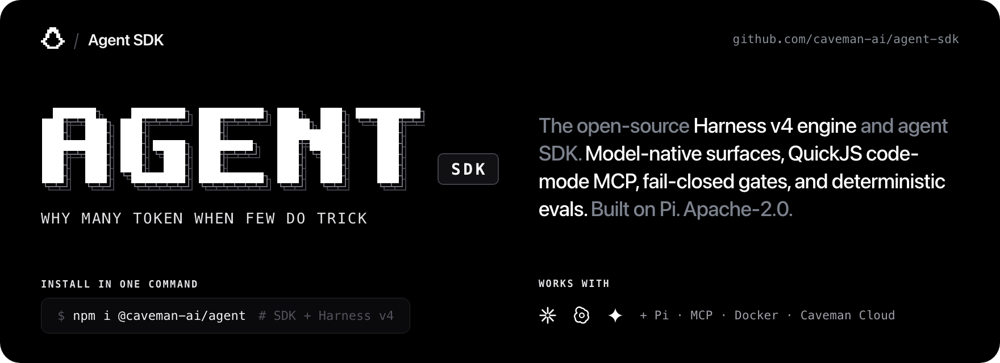

<p align="center">
  
</p>

# `@caveman-ai/agent`

The open-source TypeScript Agent SDK built on **Caveman Harness** (Apache-2.0). Define agents with typed tools, fail-closed **Caveman Gates**, declarative **Sensors**, and deterministic `AGENT.md` builds — run them directly in-process with your own Anthropic or OpenAI key, or deploy the exact same definition to Caveman Cloud.

## Install

```bash
npm install @caveman-ai/agent
```

## In-process quickstart (zero daemon, no account)

```ts
import { defineAgent, runInProcess, tool } from "@caveman-ai/agent";

const lookupInvoice = tool(
  "lookup_invoice",
  "Find an invoice by id",
  { type: "object", properties: { id: { type: "string" } }, required: ["id"] },
  async ({ id }: { id: string }) => ({ id, status: "paid", amountUsd: 42 }),
);

const billing = defineAgent({
  name: "billing",
  instructions: "Answer billing questions briefly using lookup_invoice.",
  computer: "none",
  tools: [lookupInvoice],
});

const result = await runInProcess({
  agent: billing,
  task: "Customer 4411 says they were charged twice",
  model: "anthropic/claude-sonnet-4-6", // or "openai/gpt-5.4", or pass custom { model, stream }
});

console.log(result.text, result.usage);
```

## Direct Caveman Harness entrypoint (`@caveman-ai/agent/harness`)

Need full control over multi-turn sessions, model-native loadouts (`app-gpt`, `app-claude`, `app-general`), MCP code-mode cells, or `LocalEnv` / `DockerEnv` / `SandboxEnv`? Import directly from `@caveman-ai/agent/harness`:

```ts
import { tool } from "@caveman-ai/agent";
import {
  HarnessSession,
  LocalEnv,
  appLoadoutFor,
  resolveHarnessModel,
  toHarnessTool,
} from "@caveman-ai/agent/harness";

const { model, stream } = resolveHarnessModel("anthropic/claude-sonnet-4-6");
const session = new HarnessSession({
  model,
  stream,
  loadout: appLoadoutFor(model),
  env: new LocalEnv({ cwd: process.cwd() }),
});
const outcome = await session.runTurn("List files in this directory.");
await session.close();
```

## Local runtime & Caveman Cloud (`new Caveman()`)

Run the same agent definitions with cheap-first model escalation, streaming sessions, and automations:

```ts
import { Caveman, tool } from "@caveman-ai/agent";

const cave = new Caveman(); // local runtime, or new Caveman({ apiKey: process.env.CAVEMAN_API_KEY })

await cave.run({
  agent: "builder",
  task: "Fix the flaky test",
  model: "fast",
  check: "pnpm test",
  escalate: ["base", "frontier"],
  budget: { usd: 2 },
});
```

### Sessions & streaming events

```ts
const session = await cave.sessions.create({ agent: "builder", task: "Start on #412", cwd: "." });
const following = (async () => {
  for await (const event of session.events()) console.log(event.type, event.data);
})();
await session.next();
await session.send("Also update the changelog");
await session.close();
await following;
```

## Efficient by construction

- **Model-native Caveman Harness loadouts.** `computer: "full"` or `"readonly"` selects `appLoadoutFor(model)` automatically (`app-gpt` Codex `exec` surface for GPT on Responses API; `app-claude` compact surface + 270 s cache keepalive for Claude).
- **Lean non-coding agents.** `computer: "none"` (the default for code-defined agents) sends only your declared instructions and tools — no shell or file tools in every request.
- **Byte-stable prefixes.** `compileAgentDefinition()` / `agentFileText()` emit identical bytes and a deterministic SHA-256 digest so prompt caches stay warm across turns.
- **Fail-closed Gates & allowlisted env.** Mark any tool `{ gate: { risk: "high" } }` to require explicit approval before execution. Subprocesses and stdio MCP servers run with explicit allowlists (`inheritEnv: false`).

## Examples & docs

- [5 runnable starter recipes](../../examples/basics/README.md)
- [Full documentation](../../docs/index.mdx) · [Caveman Harness Reference](../harness/README.md)

Apache-2.0.
